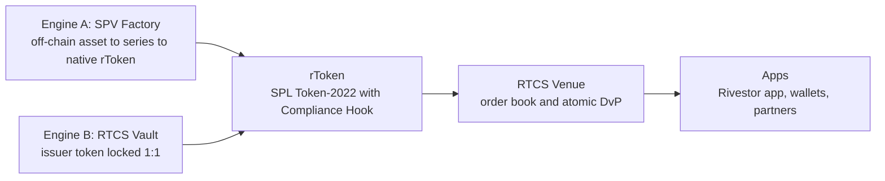

Putting an asset on-chain is no longer the hard part. The open problems are distribution (how anyone finds, trusts and resells an asset) and ownership (whether a token reflects an enforceable right in the real asset).

## The problem Rivestor addresses

| Who | What is broken | Result |
| --- | --- | --- |
| Asset issuers | They built tokenization rails, then found they also need a retail audience, a front end and a secondary market. | Supply without demand |
| Retail investors | Assets sit scattered across many issuer websites, each with its own KYC and minimums. | Demand without access |
| The market | There is no shared venue for resale, and holders face lock-ups and slow, opaque onboarding. | Capital stays frozen |

A second, quieter problem is the gap between the on-chain ledger and off-chain ownership of title. A token that is not tied to the legal owner of the asset is a promise, not a right. Rivestor treats legal isolation and on-chain compliance as parts of one system.

## The system

<CardGroup cols={3}>
  <Card title="Legal isolation" icon="landmark">
    A bankruptcy-remote SPV series and an independent Security Trustee strip the owner of sole control.
  </Card>
  <Card title="Financial control" icon="vault">
    A title protection package and a Lockbox account route income to holders, not to the former owner.
  </Card>
  <Card title="On-chain compliance" icon="shield-check">
    Token-2022 and the RTCS Compliance Hook enforce eligibility on every transfer.
  </Card>
</CardGroup>

## What Rivestor is and is not

<Columns cols={2}>
  <Card title="Is" icon="check">
    A technology provider, a marketplace and a token standard. A venue where eligible investors buy and resell.
  </Card>
  <Card title="Is not" icon="x">
    A custodian, a fund manager or an issuer of returns. Rivestor does not hold your funds and does not guarantee outcomes.
  </Card>
</Columns>

Continue with [rTokens](/concepts/rtokens) and the [dual-engine model](/concepts/dual-engine).
