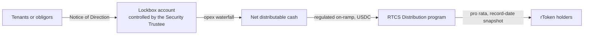

Rivestor does not promise or set returns. Issuers set the terms of each asset, and any income depends on how that asset performs. This page explains the mechanics by which income that exists reaches you.

## From the asset to your wallet

<Steps>
  <Step title="Payments go to the Lockbox">
    Tenants or, for private credit, all obligors sign an irrevocable Notice of Direction to pay the Security Trustee's Lockbox account, bypassing the former owner and the property manager.
  </Step>
  <Step title="Operating costs are released">
    Operating expenses are paid from the Lockbox under an agreed waterfall.
  </Step>
  <Step title="Cash is converted to USDC">
    The Security Trustee's banking rail converts receipts to USDC through a regulated on-ramp.
  </Step>
  <Step title="The Distribution program pays holders">
    Holders are paid pro rata against a **record-date snapshot** of the rToken register. If you trade during a period, income follows the record date, as with listed securities.
  </Step>
</Steps>

## Platform fee alignment

The platform's management fee is subordinated to investor distributions. If income falls, the platform shares the downside.

## Tax withholding

Where required (for example, US-source income paid to non-US persons), withholding is applied in the Distribution program by reference to the holder's tax-status attestation. The withheld amount is routed to the paying agent.

<Check>
  Distribution costs on Solana are a fraction of a US cent per holder, which makes frequent distributions economical.
</Check>

<Warning>
  Income shown in listings is an indicative figure set by the issuer. Rivestor does not guarantee it, and net income after trustee, audit, insurance and administration costs is lower than gross income.
</Warning>
