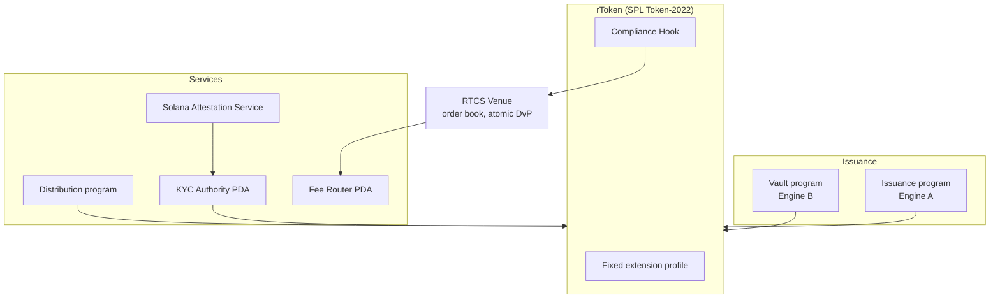

RTCS is a set of Solana programs (Rust and Anchor) that issue, wrap, govern, settle and distribute rTokens. The legal layer lives off-chain in templates and trustee structures. The compliance layer lives in the token.

<Note>
  Protocol design status: **Stage 1 to Stage 2**. Programs are built for devnet and are audited before mainnet. See [Security and governance](/protocol/security-and-governance). There is no public REST API. Integration is through the programs and, from Stage 2, the [Embedded SDK](/protocol/embedded-sdk).
</Note>

## System view

## Layers

| Layer | Responsibility | Where it lives |
| --- | --- | --- |
| Legal | Isolation of rights, title protection, register of members | SPV series, Security Trustee, Registrar |
| Technical | Issuance, vaults, compliance, distribution, settlement | RTCS programs on Solana |
| Connection | Issuers, fiat on- and off-ramp providers, partner apps | Integrations and the Embedded SDK |

## Why Solana

<Columns cols={2}>
  <Card title="Fast, cheap settlement" icon="zap">
    Blocks every ~400 ms and base fees of 5,000 lamports per signature, a fraction of a US cent. This makes small tickets and frequent distributions economical.
  </Card>
  <Card title="Token-2022 extensions" icon="puzzle">
    Compliance, fees and recovery are built into the token itself rather than bolted on at a venue.
  </Card>
  <Card title="Attestations" icon="badge-check">
    The Solana Attestation Service gives a reusable, on-chain credential for KYC and eligibility.
  </Card>
  <Card title="A growing RWA network" icon="database">
    Solana is Rivestor's home chain. It ranked as the third-largest RWA network by value in October 2026 (RWA.xyz).
  </Card>
</Columns>

## Reading order

<CardGroup cols={2}>
  <Card title="Programs" icon="blocks" href="/protocol/programs">
    What each RTCS program does.
  </Card>
  <Card title="Token-2022 extensions" icon="puzzle" href="/protocol/token-extensions">
    The extension profile and who controls each extension.
  </Card>
  <Card title="Compliance Hook" icon="shield-check" href="/protocol/compliance-hook">
    The six checks on every transfer.
  </Card>
  <Card title="Settlement and venue" icon="arrow-right-left" href="/protocol/settlement-and-venue">
    Order book, atomic DvP and finality.
  </Card>
</CardGroup>
